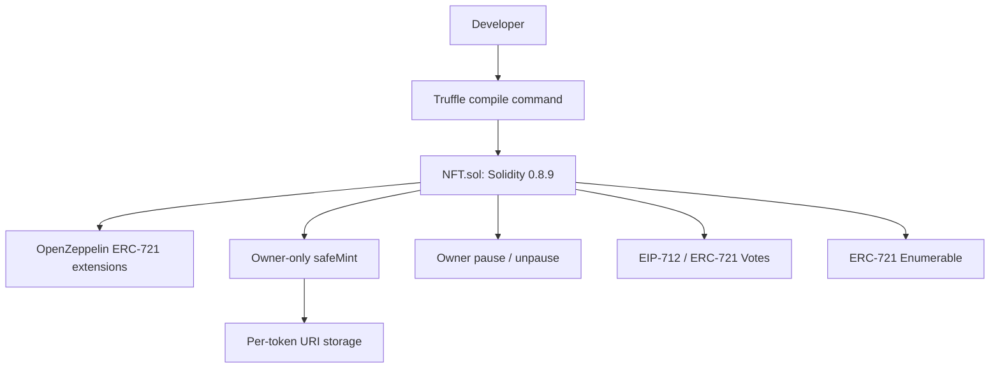

# Q702 — Architecture

## Verified contract architecture

## Contract composition
`contracts/NFT.sol` defines `NFT`, inheriting:
- `ERC721`, `ERC721Enumerable`, and `ERC721URIStorage`
- `Pausable`, `Ownable`, and `ERC721Burnable`
- `EIP712` and `ERC721Votes`

The constructor receives `name`, `symbol`, and `version`. `safeMint` is restricted by `onlyOwner`, increments a private counter, safely mints to the requested address, and stores the supplied URI. Transfers are guarded by `whenNotPaused`.

## Build and network configuration
The package manifest defines `truffle compile` and declares Truffle 5.7.8 plus OpenZeppelin contracts packages. `truffle-config.js` includes local development-network configuration and commented deployment examples. The Infura/HDWalletProvider example is commented out; it must not be described as configured or usable without further setup.

## Missing or unverified components
- No active deployment network or contract address verified.
- No frontend or wallet integration verified.
- No metadata-generation or hosting pipeline verified.
- No successful test suite verified; package test script is a failing placeholder.
- No contract audit or formal verification performed.

## Security note
The presence of OpenZeppelin base contracts does not establish that this specific composition is safe. Review inheritance compatibility, access control, voting behavior, pause semantics, deployment parameters, and tests before any release.