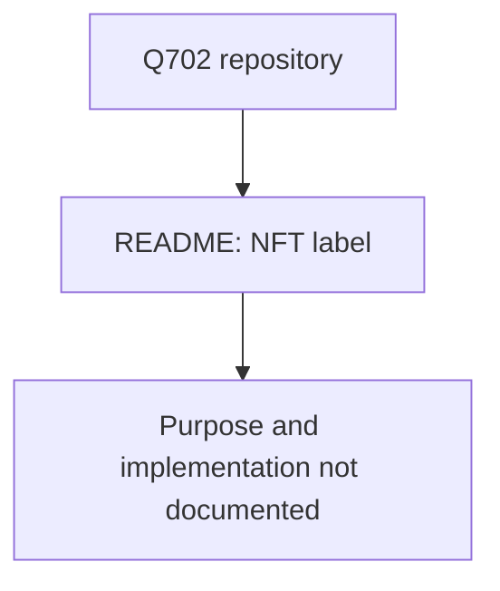

# Q702 — Architecture

## Current evidence
The repository README reviewed for this pass contains only `# NFT`.

## Architecture map

## Not yet verified
- Blockchain/network selection
- Smart contracts and contract addresses
- Token standard and metadata storage
- Wallet connection and signing flow
- Frontend or backend framework
- Deployment, testing, and security controls

## Next documentation step
Inspect the source tree and identify the actual product boundary before documenting components or security assumptions.